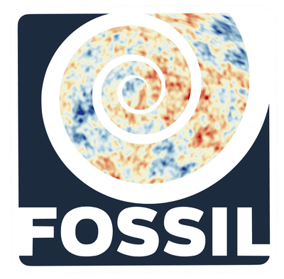

<p align="center">
  
</p>

<h1 align="center">fossil_sim</h1>

<p align="center">
  <a href="https://github.com/paganol/fossil_sim/actions/workflows/tests.yml"></a>
  <a href="https://fossil-sim.readthedocs.io"></a>
  <a href="https://arxiv.org/abs/2609.17618"></a>
  <a href="LICENSE"></a>
</p>

`fossil_sim` is the simulation framework for
[**FOSSIL**](https://fossil.ias.universite-paris-saclay.fr/), a space mission
proposed to ESA for its M8 Medium-class opportunity to measure the spectral
distortions of the Cosmic Microwave Background with an absolute,
dual-input/dual-output polarising Fourier Transform Spectrometer
(50 GHz – 2 THz).

The framework simulates the full chain from sky to maps: scanning strategy and
pointing, sky model, interferogram generation, instrumental effects,
calibration and map-making.

- **Mission website:** <https://fossil.ias.universite-paris-saclay.fr/>
- **Documentation:** <https://fossil-sim.readthedocs.io> (sources in [`docs/`](docs))
- **Mission paper:** [arXiv:2609.17618](https://arxiv.org/abs/2609.17618)

## Table of contents

- [Installation](#installation)
- [Quick start](#quick-start)
- [Notebooks and examples](#notebooks-and-examples)
- [Testing](#testing)
- [Conventions](#conventions)
- [How to cite](#how-to-cite)
- [License](#license)

## Installation

`fossil_sim` requires Python ≥ 3.12 and uses [uv](https://docs.astral.sh/uv/):

```sh
git clone https://github.com/paganol/fossil_sim.git
cd fossil_sim
uv sync --extra dev
```

Optional extras: `mpi` (mpi4py), `docs` (Sphinx), `oracle` (litebird_sim, used
only for validation). See the
[installation guide](https://fossil-sim.readthedocs.io) for details.

## Quick start

```sh
uv run python examples/hitmaps.py         # hit maps + report in output/hitmaps
uv run python examples/spectral_maps.py   # 6-month spectral maps + report in output/spectral_maps
```

## Notebooks and examples

- [Scanning](notebooks/fossil_sim_scanning.ipynb)
- [Interferogram](notebooks/fossil_sim_interferogram.ipynb)
- [Spectral maps](notebooks/fossil_sim_spectral_maps.ipynb)

Re-execute them with `uv run python scripts/build_notebooks.py`.

## Testing

```sh
uv run pytest                                   # unit tests + doctests
uv run --with litebird_sim --with "git+https://github.com/paganol/BISOU-sky" pytest -m heavy  # oracles
uv run --with mpi4py mpirun -n 3 python scripts/mpi_check.py
```

## Conventions

Same rules as [litebird_sim](https://github.com/litebird/litebird_sim), from
which several design ideas are taken (code is rewritten, it is not a
dependency):

- measure units are always explicit in variable, parameter and config-key
  names, lowercase suffix: `freq_ghz`, `time_s`, `temperature_k`,
  `theta_rad`, `v_km_s`, `intensity_mjy_sr`;
- every function has a numpy-style docstring; every module has tests in `test/`;
- `ruff format` and `ruff check` must pass;
- numba is used for per-sample kernels.

Internal units: GHz, MJy/sr, s (relative to `mission_start`), rad, K, km/s.

Further reading: [CHANGELOG.md](CHANGELOG.md) (release history),
[CONTEXT.md](CONTEXT.md) (domain language), [docs/adr](docs/adr) (design
decisions).

## How to cite

If you use `fossil_sim` in your work, please cite the FOSSIL mission paper:

> N. Aghanim, B. Maffei, J. Aumont, et al., *FOSSIL: A future mission for CMB
> spectral distortion measurements*, 2026,
> [arXiv:2609.17618](https://arxiv.org/abs/2609.17618)

```bibtex
@misc{aghanim2026fossilfuturemissioncmb,
      title={FOSSIL: A future mission for CMB spectral distortion measurements},
      author={N. Aghanim and B. Maffei and J. Aumont and A. Beelen and B. Borgo and E. Bozzo and J. Chluba and X. Coulon and S. Couturier and F. Cuttaia and B. Cyr and P. De Bernardis and C. De Jabrun and J. -J. Diaz-Garcia and D. Eckert and G. Fabbian and L. Ferrari and F. Finelli and T. Gascard and J. E. Gudmundsson and A. Kogut and G. Lagache and M. Loquet Le Gall and S. Martin and A. I. Silva Martins and A. Monfardini and C. O'Sullivan and L. Pagano and D. Paoletti and G. Pisano and M. Remazeilles and V. Reveret and J. A. Rubino-Martin and V. Sauvage and G. Savini and L. Spencer and A. Tartari and L. Terenzi and N. Trappe and D. Watts and B. Winter and E. Baker and E. S. Battistelli and R. Battye and J. L. Bernal and A. Besnard and F. R. Bouchet and M. Braglia and C. Burigana and M. Calvo and S. Caminade and M. Citran and D. Clements and W. Coulton and E. Courau and G. De Zotti and E. Di Valentino and H. Dole and G. Domenech and S. Evangelista and S. Farrens and M. Frailis and K. A. Glasscock and V. Hervier and E. Kovetz and H. Liu and T. Louis and F. Madec and A. S. Maniyar and C. J. A. P. Martins and S. Masi and L. Maurin and F. Moll and L. Morelli and S. K. Naess and A. Nicola and F. Pace and N. Ponthieu and V. Poulin and E. Prele and N. Sanchez and W. Qin and L. Rodriguez and D. Scott and F. Simon and J. Singal and T. Slatyer and E. M. Teixeira and L. Thiele and M. Tristram and T. Trombetti and L. Vacher and S. Vinzl and A. Zacchei and E. Allys and K. Aryan and J. M. Casas Gonzales and O. Lahav and C. Sidiropoulos},
      year={2026},
      eprint={2609.17618},
      archivePrefix={arXiv},
      primaryClass={astro-ph.CO},
      url={https://arxiv.org/abs/2609.17618},
}
```

## License

`fossil_sim` is released under the [GNU General Public License v3.0](LICENSE).
